# Samples

Screenshots of every sample ported so far, captured on a PSP-1000 at 480×272. Each row keeps the sample name
beside its screenshot; the capture shown is the first of a byte-identical pair, and the second was required to
match before it was trusted. The page grows with [Phase 13](../psp/phases/13-samples-porting/index.md) and will
eventually cover all 227 upstream samples across the eight categories.

## PSP

Samples written for this port rather than ported from upstream raylib.

| Sample | Screenshot |
|---|---|
| `psp_showcase` | 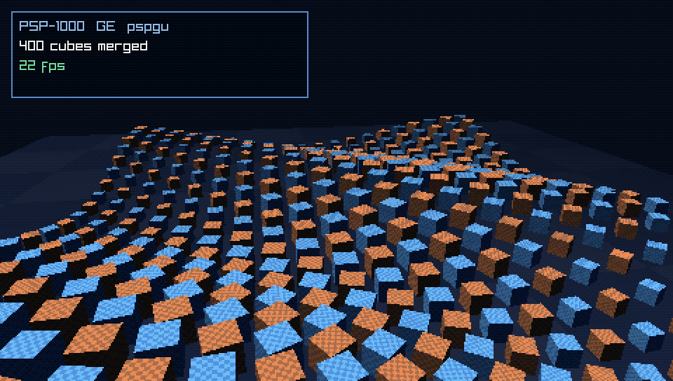 |
| `psp_2d_showcase` | 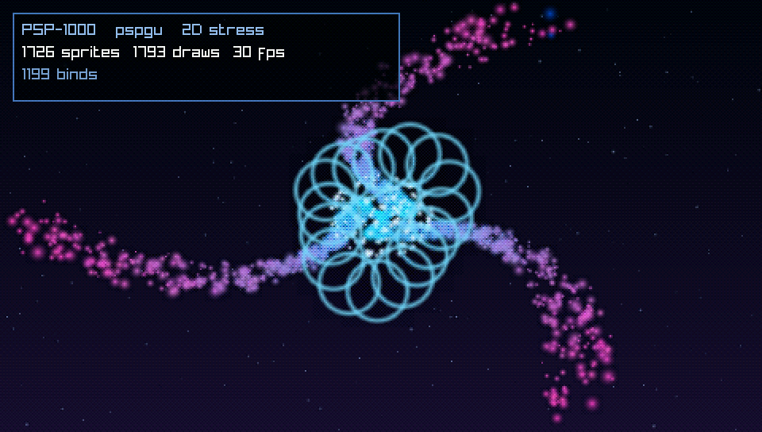 |

**`psp_showcase`** — a stress demo for the 3D path as it stands after sprint 078. 400 lit, textured cubes ride a
sine wave under an orbiting camera, split into two merged colour runs (cool/warm), over a fogged checker ground,
with a 2D HUD. It draws about **24 fps** at 480×272 on a PSP-1000, with **2 merged draws** for the 400 cubes and
one per-object draw for the ground; the HUD reports the live count and frame rate.

Source: `psp-tests/samples/psp/psp_showcase/`. Build with `make` (runs until power-off) or `make FRAMES=600`
(stops after 600 frames, prints statistics and sleeps, which is what the capture workflow needs).

**`psp_2d_showcase`** — the 2D counterpart and the other half of the benchmark pair. 1,300 additive glow
particles in three arms, a 250-star field, a 160-particle hot core and 16 ring sprites, over a 40-band gradient:
about **1,566 sprites** drawn in **6 draws / 4 texture runs** per frame at **29.6 fps** (33.8 ms). The animation is
driven by the **frame index**, so frame N draws exactly the same scene on every build; the counters come from the
link-time `--wrap` harness (`draws`, `binds`, vertices), which is what makes a before/after comparison meaningful.

Source: `psp-tests/samples/psp/psp_2d_showcase/`. `make FRAMES=300` for the capture build, `make SPRITES=3000
STARS=0` to sweep the load.

## Core

| Sample | Screenshot |
|---|---|
| `core_basic_window` |  |
| `core_custom_logging` |  |
| `core_random_values` |  |
| `core_3d_camera_mode` |  |
| `core_2d_camera_mouse_zoom` |  |
| `core_2d_camera_platformer` | 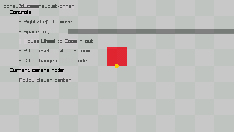 |
| `core_2d_camera` | 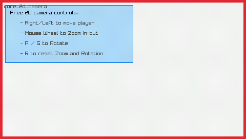 |
| `core_3d_camera_first_person` | 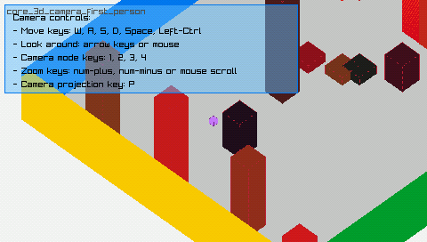 |
| `core_3d_camera_fps` | 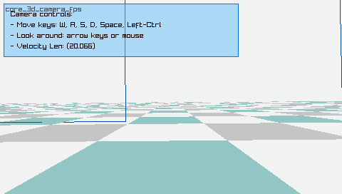 |
| `core_3d_camera_free` | 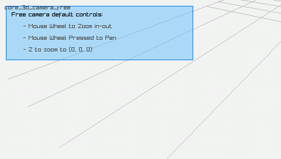 |
| `core_3d_picking` | 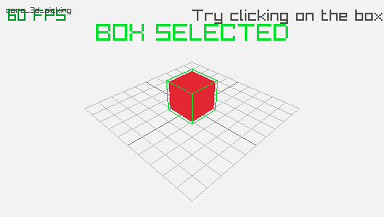 |
| `core_basic_screen_manager` | 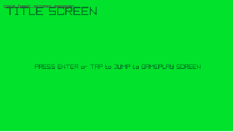 |
| `core_compute_hash` | 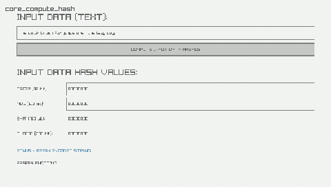 |
| `core_custom_frame_control` | 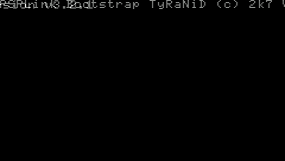 |
| `core_delta_time` | 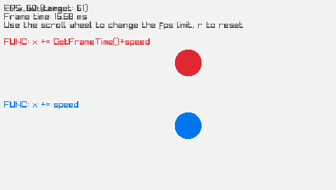 |
| `core_directory_files` | 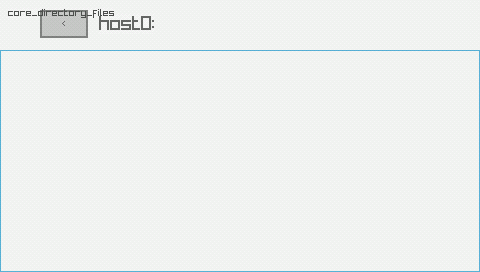 |
| `core_input_actions` | 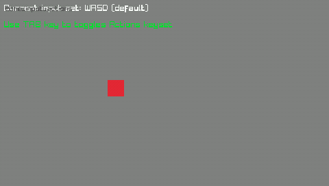 |
| `core_random_sequence` | 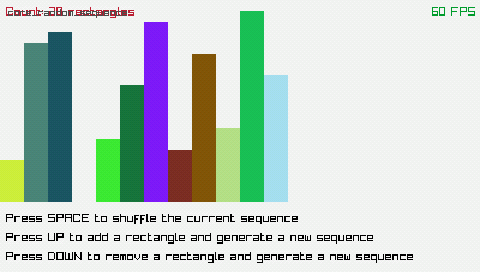 |
| `core_scissor_test` | 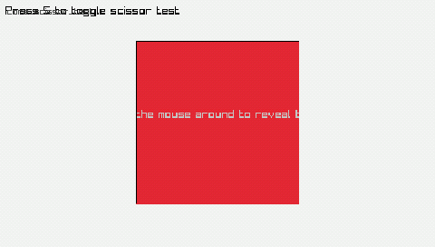 |
| `core_screen_recording` | 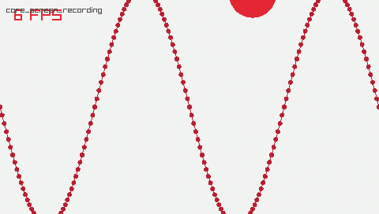 |
| `core_storage_values` | 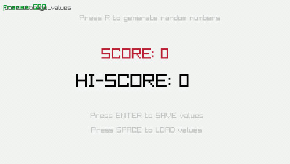 |
| `core_text_file_loading` | 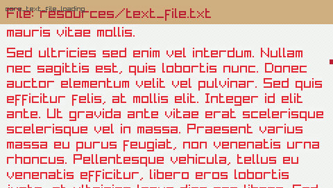 |
| `core_world_screen` | 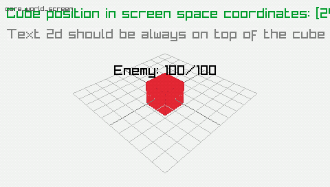 |

## Shapes

| Sample | Screenshot |
|---|---|
| `shapes_logo_raylib` |  |
| `shapes_math_angle_rotation` | 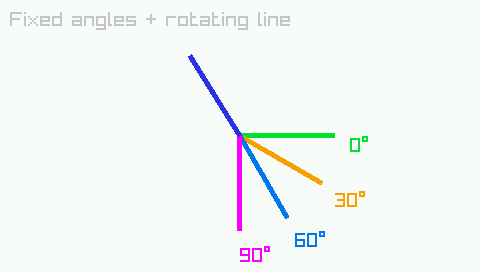 |
| `shapes_outlines_thickness` | 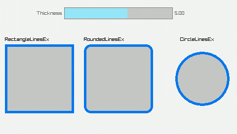 |
| `shapes_circle_sector_drawing` | 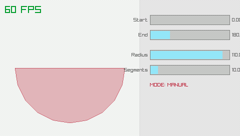 |
| `shapes_rectangle_advanced` |  |
| `shapes_ball_physics` | 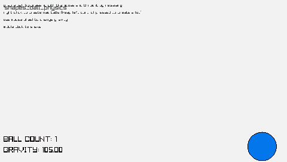 |
| `shapes_basic_shapes` | 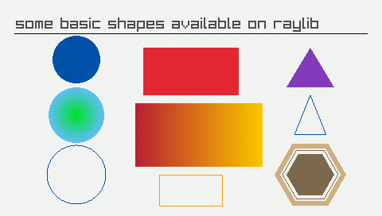 |
| `shapes_bouncing_ball` | 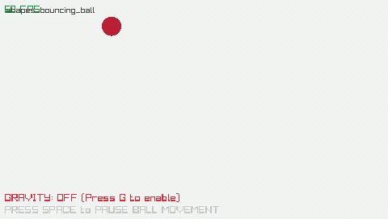 |
| `shapes_clock_of_clocks` | 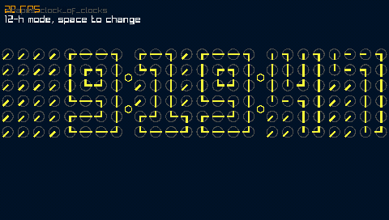 |
| `shapes_colors_palette` | 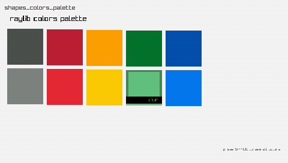 |
| `shapes_dashed_line` | 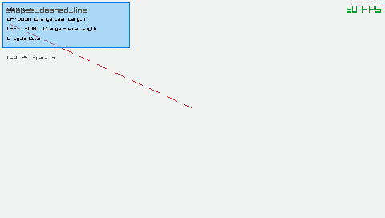 |
| `shapes_digital_clock` | 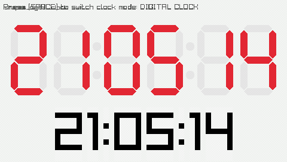 |
| `shapes_drag_puzzle` | 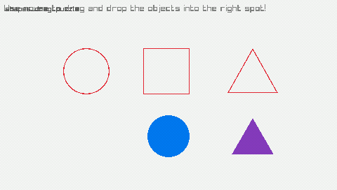 |
| `shapes_easings_ball` | 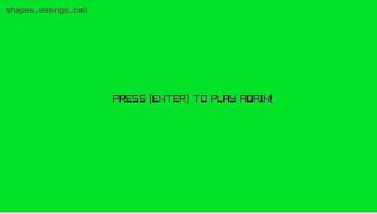 |
| `shapes_easings_box` | 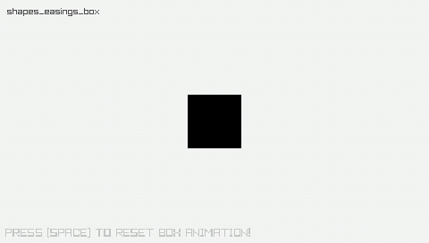 |
| `shapes_easings_rectangles` | 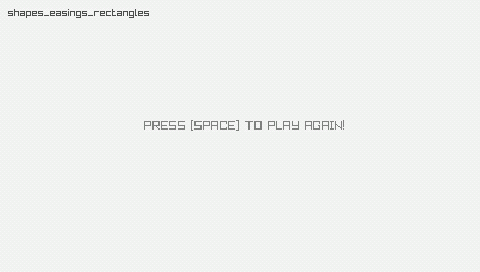 |
| `shapes_easings_testbed` | 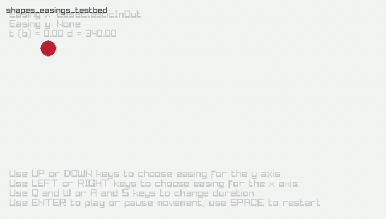 |
| `shapes_ellipse_collision` | 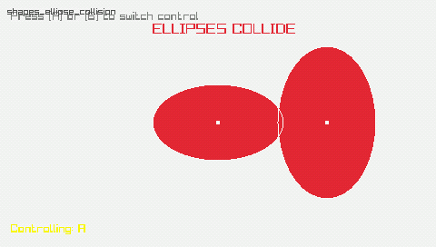 |
| `shapes_following_eyes` | 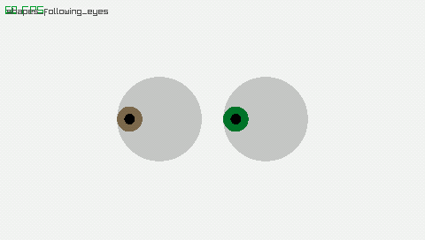 |
| `shapes_hilbert_curve` | 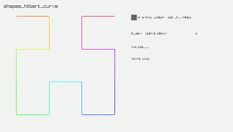 |
| `shapes_lines_bezier` | 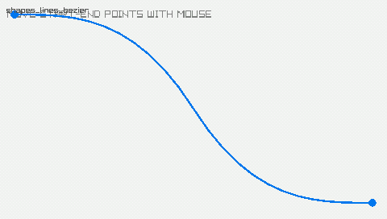 |
| `shapes_math_sine_cosine` | 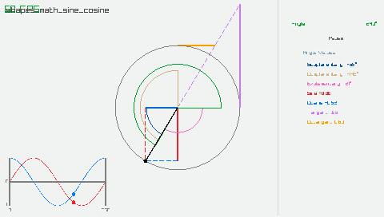 |

## Textures

| Sample | Screenshot |
|---|---|
| `textures_image_loading` |  |
| `textures_logo_raylib` | 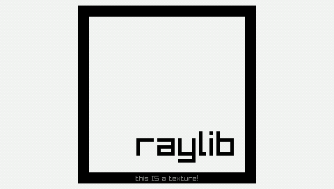 |
| `textures_screen_buffer` |  |
| `textures_srcrec_dstrec` |  |
| `textures_cellular_automata` |  |
| `textures_gif_player` | 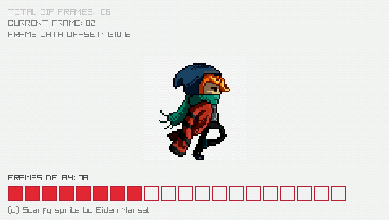 |
| `textures_image_rotate` | 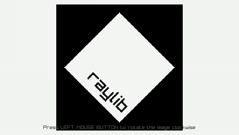 |
| `textures_npatch_drawing` | 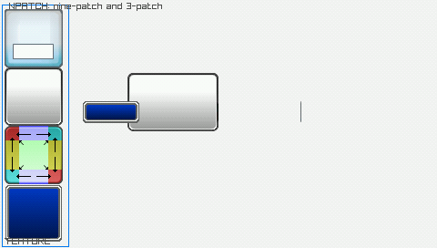 |
| `textures_particles_blending` |  |
| `textures_sprite_animation` |  |
| `textures_textured_curve` | 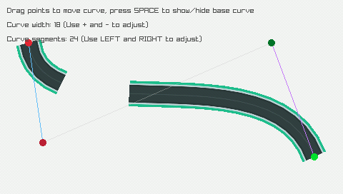 |
| `textures_tiled_drawing` |  |
| `textures_image_kernel` | 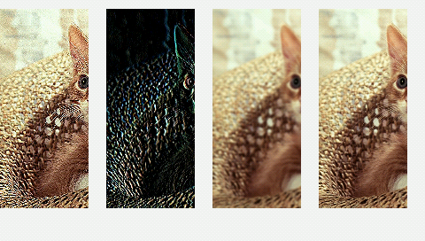 |
| `textures_image_processing` | 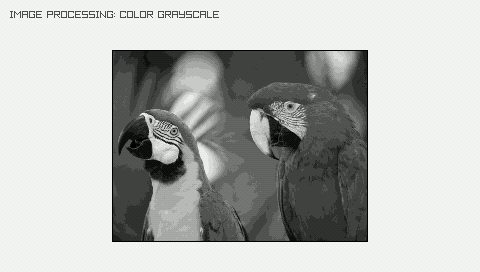 |
| `textures_image_text` |  |
| `textures_polygon_drawing` | 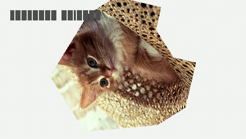 |
| `textures_raw_data` |  |
| `textures_background_scrolling` |  |
| `textures_blend_modes` | 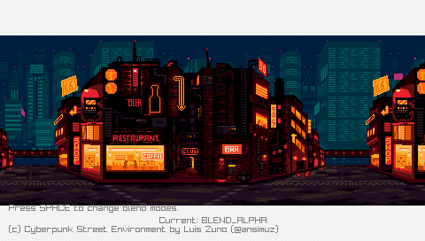 |
| `textures_bunnymark` | 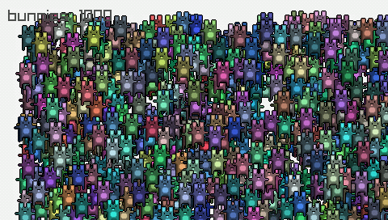 |

`textures_image_rotate` shows the 45° case introduced in P13-S7; the 90° and -90° rotations were captured in
P13-S2. The P13-S2 and P13-S7 texture samples use different pspgu arms where needed; the sprint pages record which
arm produced each capture.

## Audio

Nine of the eleven `examples/audio` samples. `audio_sound_positioning` waits for Phase 10's 3D path;
`audio_spectrum_visualizer` waits for the P13-S16 shader policy.

| Sample | Screenshot |
|---|---|
| `audio_sound_loading` |  |
| `audio_sound_multi` |  |
| `audio_music_stream` |  |
| `audio_mixed_processor` |  |
| `audio_module_playing` |  |
| `audio_raw_stream` |  |
| `audio_stream_callback` |  |
| `audio_amp_envelope` |  |
| `audio_stream_effects` |  |

Not in this gallery: `batch_check` (the deterministic render gate). Its captures are archived in
`/home/psp/evidence/sprint030/`.
