# Samples

Screenshots of every sample ported so far, captured on a PSP-1000 at 480×272. Each row keeps the sample name
beside its screenshot; the capture shown is the first of a byte-identical pair, and the second was required to
match before it was trusted. The page grows with [Phase 13](../psp/phases/13-samples-porting/index.md) and will
eventually cover all 227 upstream samples across the eight categories.

## Core

| Sample | Screenshot |
|---|---|
| `core_basic_window` | 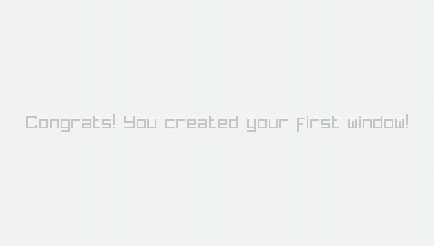 |
| `core_custom_logging` | 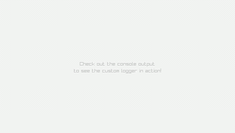 |
| `core_random_values` | 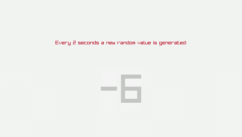 |
| `core_3d_camera_mode` | 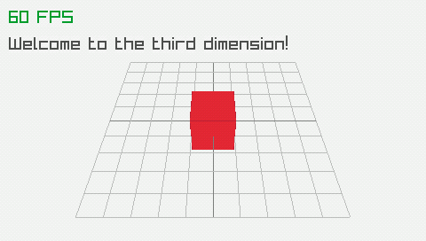 |

## Shapes

| Sample | Screenshot |
|---|---|
| `shapes_logo_raylib` | 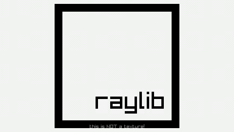 |
| `shapes_math_angle_rotation` |  |
| `shapes_outlines_thickness` |  |
| `shapes_circle_sector_drawing` |  |
| `shapes_rectangle_advanced` | 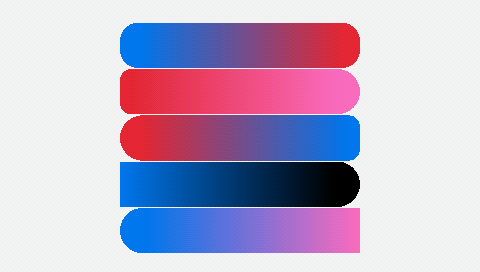 |

## Textures

| Sample | Screenshot |
|---|---|
| `textures_image_loading` | 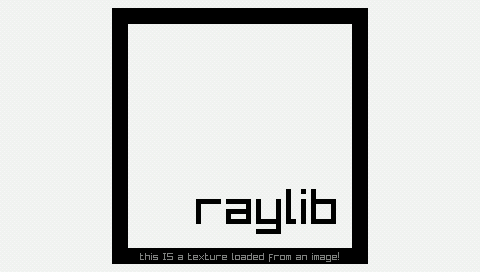 |
| `textures_logo_raylib` |  |
| `textures_screen_buffer` | 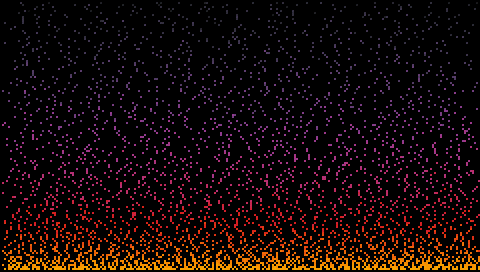 |
| `textures_srcrec_dstrec` | 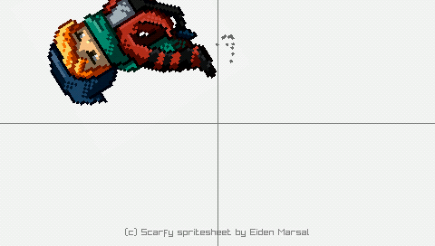 |
| `textures_cellular_automata` | 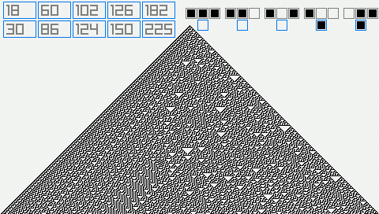 |
| `textures_gif_player` |  |
| `textures_image_rotate` |  |
| `textures_npatch_drawing` |  |
| `textures_particles_blending` | 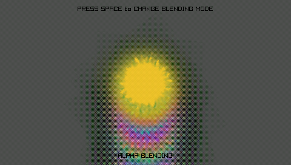 |
| `textures_sprite_animation` | 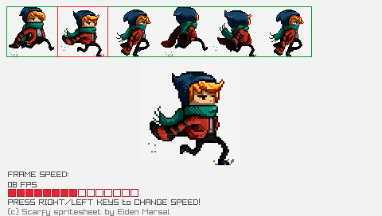 |
| `textures_textured_curve` |  |
| `textures_tiled_drawing` | 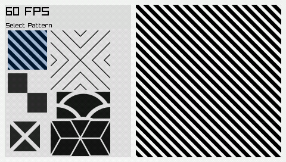 |
| `textures_image_kernel` |  |
| `textures_image_processing` |  |
| `textures_image_text` |  |
| `textures_polygon_drawing` |  |
| `textures_raw_data` | 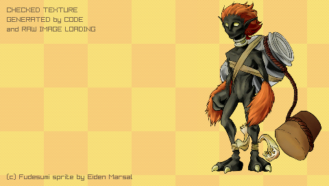 |
| `textures_background_scrolling` | 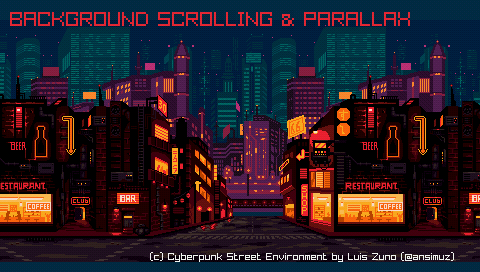 |
| `textures_blend_modes` |  |

`textures_image_rotate` shows the 45° case introduced in P13-S7; the 90° and -90° rotations were captured in
P13-S2. The P13-S2 and P13-S7 texture samples use different pspgu arms where needed; the sprint pages record which
arm produced each capture.

Not in this gallery: `basic_shapes` (the 284-colour parity gate) and `batch_check` (the deterministic render
gate). Their captures are archived in `/home/psp/evidence/sprint030/`.
